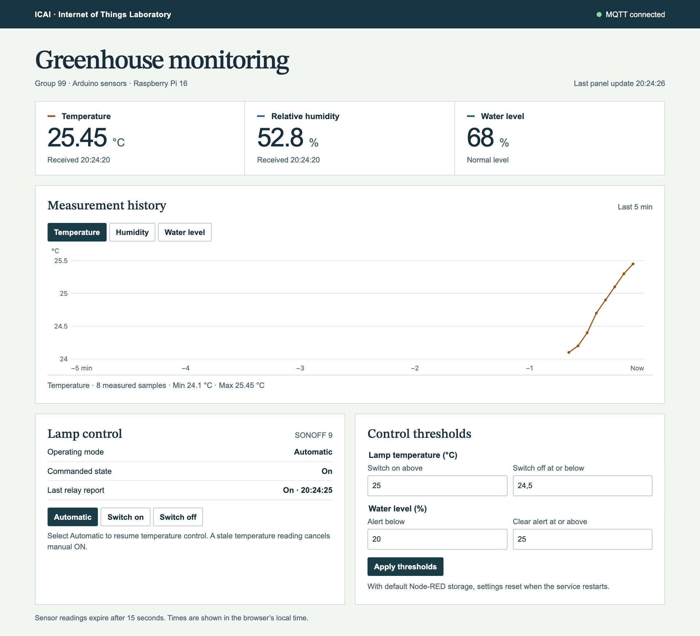

# Invernadero · Grupo 99

El grupo confirmó en el laboratorio el 25 de noviembre de 2026 que funciona la demo con el Arduino como fuente de temperatura, humedad y nivel, la Raspberry 16 con Node-RED y el SONOFF 9 por MQTT.

**Flow para importar:** [demo-arduino-grupo99.json](node-red/demo-arduino-grupo99.json). El dashboard permite consultar sensores, controlar el SONOFF y ajustar los umbrales. Para actualizar una demo desplegada, importá el JSON actualizado en Node-RED. Para preparar otra Raspberry, seguí el [manual de la demo](demo-arduino.md).

*Vista de ejemplo con lecturas simuladas en un broker MQTT local.*

| Componente | Configuración probada |
| --- | --- |
| Broker | `broker.hivemq.com:1883` |
| Sensores | El firmware del Arduino del grupo publica en `IIoT/grupo99/temperatura`, `IIoT/grupo99/humedad` e `IIoT/grupo99/nivel` |
| Raspberry 16 | Node-RED recibe los datos y sirve el [dashboard local](http://127.0.0.1:1880/ui). El Sense HAT indica el nivel de agua en la matriz |
| SONOFF 9 | `IIoT/9/relay/0/set` recibe `1` por encima de 25 °C y `0` a 24,5 °C o menos. El relé informa en `IIoT/9/relay/0` |

También están disponibles las [herramientas de terminal para MQTT](mqtt-lab/README.md).
